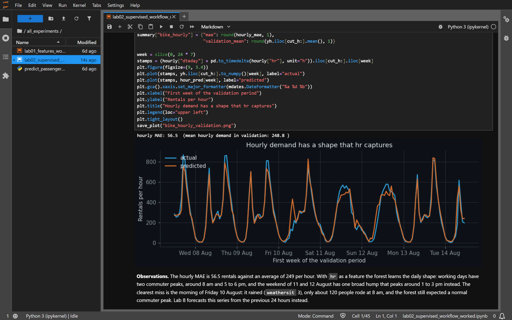
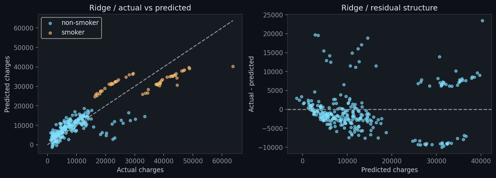
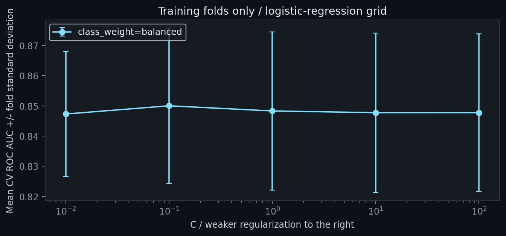

<div align="center">
  <picture>
    <source media="(prefers-color-scheme: dark)" srcset=".github/readme/banner-dark.svg">
    <source media="(prefers-color-scheme: light)" srcset=".github/readme/banner-light.svg">
    
  </picture>
</div>

<div align="center">
  <picture>
    <source media="(prefers-color-scheme: dark)" srcset=".github/readme/card-dark.svg">
    <source media="(prefers-color-scheme: light)" srcset=".github/readme/card-light.svg">
    
  </picture>
</div>

<p align="center">
  <a href="#hafizml-lab-ls-all_experiments"></a>
  <a href="#hafizml-lab-cat-resultssummaryjson"></a>
  <a href="#hafizml-lab-python--m-venv-venv"></a>
</p>

```text
hafiz@ml-lab:~$ cat ./about
worked notebooks for teb3123 machine learning at utp, one per lab. each one
follows its handout part by part, does the try-it exercises, answers the
questions, and saves every chart and table it draws.

hafiz@ml-lab:~$ cd all_experiments
hafiz@ml-lab:~/all_experiments$ python predict_passenger.py --pclass 2 --sex female --age 30 --fare 20
survival probability: 0.805  ->  survived
(model: logistic regression pipeline, test ROC AUC 0.837)
```

### <samp>hafiz@ml-lab:~$ jupyter lab</samp>

<p align="center">
  
</p>

Each part opens with a short note on what it does and closes with an **Observations** cell that
says what the numbers show. Above is Lab 2, Part B: the forest picks up the two commuter peaks of
a working day and misses a rainy Friday morning.

### <samp>hafiz@ml-lab:~$ ls all_experiments/</samp>

| lab | notebook | topic | datasets | status |
|:-:|:--|:--|:--|:-:|
| 01 | [`lab01_features_worked`](all_experiments/lab01_features_worked.ipynb) | Feature engineering and selection | Titanic, breast cancer, student performance | done |
| 02 | [`lab02_supervised_workflow_worked`](all_experiments/lab02_supervised_workflow_worked.ipynb) | Regression, classification, the workflow | Insurance, bike sharing, Titanic, breast cancer, heart disease | done |
| 03 | `lab03_supervised_models_worked` | KNN, naive Bayes, SVM, trees, ensembles | Breast cancer, Titanic, Ames housing, red wine | next |
| 04 | `lab04_clustering_pca_worked` | K-means, DBSCAN, PCA | Mall customers, digits | |
| 05 | `lab05_anomaly_limited_labels_worked` | Anomaly detection, limited labels | Credit card fraud, breast cancer | |
| 06 | `lab06_reinforcement_worked` | Reinforcement learning | | |
| 07 | `lab07_deep_learning_cnn_worked` | CNNs | Digits | |
| 08 | `lab08_deep_learning_lstm_worked` | LSTM forecasting | Bike sharing | |

[`predict_passenger.py`](all_experiments/predict_passenger.py) sits next to the notebooks and
loads the model Lab 2 saves, without retraining.

### <samp>hafiz@ml-lab:~$ cat ./marking-guide</samp>

Where each handout task lives. Both notebooks are committed with their outputs, so GitHub shows
every result without running anything.

| lab | the handout asks for | where it is |
|:-:|:--|:--|
| 01 | Parts A to D | the Part A to Part D sections, each closing with Observations |
| 01 | Try it yourself: cabin initial and fare per family member | Part B, under *Try it yourself* |
| 01 | Try it yourself: SelectKBest with k=5 and k=20 | Part D, next to k=10 |
| 01 | Check your understanding (3 questions) | the last section |
| 02 | Parts A to E | the Part A to Part E sections |
| 02 | Decision memo | the end of Part C, after the ROC and PR curves |
| 02 | Run `predict_passenger.py` from the terminal | Part E, with its output; the script is in `all_experiments/` |
| 02 | Try it yourself: heart disease | the section after Part E |
| 02 | Check your understanding (3 questions), plus Chapter 4's | the last two sections |

### <samp>hafiz@ml-lab:~$ open results/lab01/</samp>

<table>
  <tr>
    <td width="50%"><samp>same model, same split, new features</samp></td>
    <td width="50%"><samp>same five tumours, two geometries</samp></td>
  </tr>
  <tr>
    <td></td>
    <td></td>
  </tr>
  <tr>
    <td>Family size, title and log fare lift Titanic validation ROC AUC from 0.842 to 0.872. The deck letter and fare per family member add nothing on top.</td>
    <td>Raw distances are almost pure tumour area. After standardizing, tumour 5's nearest neighbour changes from tumour 3 to tumour 2.</td>
  </tr>
</table>

<p align="center">
  
</p>

Predicting final grades at enrolment: ten columns do as well as thirty (MAE 2.14 against 2.18),
and lasso does best at 2.08 with 16 columns. The orange bar is the trap. Add the second-period
grade `G2` and the error drops to 0.76, a score nobody can get on enrolment day.

### <samp>hafiz@ml-lab:~$ open results/lab02/</samp>

<table>
  <tr>
    <td width="50%"><samp>two models, two metrics, two winners</samp></td>
    <td width="50%"><samp>one model, two thresholds</samp></td>
  </tr>
  <tr>
    <td></td>
    <td></td>
  </tr>
  <tr>
    <td>The random forest wins on accuracy (0.798 against 0.776) and logistic regression on ROC AUC (0.842 against 0.834). Gaps this small need cross-validation to call.</td>
    <td>Lowering the threshold from 0.50 to 0.30 catches two more malignant tumours (missed ones drop from 4 to 2) and adds no false alarm.</td>
  </tr>
  <tr>
    <td><samp>the smoker bands</samp></td>
    <td><samp>the folds disagree more than the settings</samp></td>
  </tr>
  <tr>
    <td></td>
    <td></td>
  </tr>
  <tr>
    <td>Smokers split into two residual bands: lean smokers come out about $9,000 too high, smokers with a BMI of 30 or more about $7,000 too low. A linear model without an interaction term cannot fix that.</td>
    <td>All ten settings of C and class weight score between 0.847 and 0.850, inside a fold to fold spread of about 0.02. The pick (C=0.1, balanced) tests at 0.837.</td>
  </tr>
</table>

### <samp>hafiz@ml-lab:~$ cat results/*/summary.json</samp>

| lab | experiment | result |
|:-:|:--|:--|
| 01 | Titanic, raw columns against engineered features | validation ROC AUC 0.842 → 0.872 |
| 01 | Student grades at enrolment, lasso | MAE 2.08 grade points, 16 of 56 columns kept |
| 02 | Insurance charges, OLS | MAE $4,181, R² 0.784 |
| 02 | Daily bike rentals, random forest | MAE 1,040 a day (average day 5,898) |
| 02 | Hourly bike rentals, random forest | MAE 56.5 an hour (average hour 249) |
| 02 | Titanic, logistic regression tuned by 5-fold CV | CV ROC AUC 0.850, test 0.837 |
| 02 | Breast cancer, threshold 0.50 → 0.30 | recall 0.925 → 0.962, precision 0.98 at both |
| 02 | Heart disease (try it yourself) | accuracy 0.883, ROC AUC 0.932 |

The decision memo for the cancer threshold closes Part C of
[Lab 2](all_experiments/lab02_supervised_workflow_worked.ipynb).

### <samp>hafiz@ml-lab:~$ python -m venv .venv</samp>

Route A from the course setup chapter, on Windows with Python 3.12:

```powershell
git clone https://github.com/hafizmnazman/ml-lab.git
cd ml-lab
py -3.12 -m venv .venv
.venv\Scripts\Activate.ps1
python -m pip install -r requirements.txt
jupyter lab all_experiments
```

On macOS or Linux, create it with `python3 -m venv .venv` and activate it with
`source .venv/bin/activate`. Open a notebook and choose **Run > Run All Cells**. In VS Code, open
the notebook, pick the `.venv` interpreter as the kernel and press **Run All**. Both start the
notebook inside `all_experiments/`, which is where the code expects to run.

### <samp>hafiz@ml-lab:~$ tree -L 2</samp>

```text
all_datasets/        the 12 course datasets, unchanged (the digits zip stays zipped for lab 4)
all_experiments/     one worked notebook per lab, plus predict_passenger.py
models/              the pipelines lab 2 saves, and the titanic model card
results/lab01/       charts, tables and summary.json from the lab 1 notebook
results/lab02/       the same for lab 2
requirements.txt     the course packages, pinned to the versions the notebooks ran with
course_materials/    the lecturer's handouts, kept on this machine only (gitignored)
.github/readme/      the banner, the card and the screenshot on this page
```

The layout follows the course setup chapter, so each new lab adds one
`labNN_..._worked.ipynb` and one `results/labNN/`.

### <samp>hafiz@ml-lab:~$ cat ./notes</samp>

- Lab 2, Part D reuses the Part C split, as the handout does, so Part C had already scored two
  models on the Titanic test rows. The tuning never sees them, but strictly they are not fresh.
  The notebook says so where it happens.
- In Lab 1 the handout's `coef_ != 0` count says lasso kept 18 columns. Two of those
  coefficients are around 1e-15, floating-point noise from one-hot pairs that always sum to 1,
  so 16 is the real count.
- The numbers on this page come from one run with `random_state=42` on the pinned versions.
  Other package versions can move the last decimal.

### <samp>hafiz@ml-lab:~$ cat ./credits</samp>

The datasets are the course's copies of these Kaggle datasets, and each source page lists its
licence: [Titanic](https://www.kaggle.com/datasets/yasserh/titanic-dataset),
[Breast Cancer Wisconsin](https://www.kaggle.com/datasets/uciml/breast-cancer-wisconsin-data),
[Student Performance](https://www.kaggle.com/datasets/larsen0966/student-performance-data-set),
[Medical Cost Personal](https://www.kaggle.com/datasets/mirichoi0218/insurance),
[Bike Sharing](https://www.kaggle.com/datasets/lakshmi25npathi/bike-sharing-dataset),
[Heart Failure Prediction](https://www.kaggle.com/datasets/fedesoriano/heart-failure-prediction),
[Ames Housing](https://www.kaggle.com/datasets/shashanknecrothapa/ames-housing-dataset),
[Red Wine Quality](https://www.kaggle.com/datasets/uciml/red-wine-quality-cortez-et-al-2009),
[Mall Customers](https://www.kaggle.com/datasets/vjchoudhary7/customer-segmentation-tutorial-in-python),
[Optical Recognition of Handwritten Digits](https://www.kaggle.com/datasets/yadavhim/optical-recognition-of-handwritten-digits)
and [Credit Card Fraud Detection](https://www.kaggle.com/datasets/miadul/credit-card-fraud-detection-dataset).
The lab handouts belong to the course and stay out of this repo.

<sub>The banner and card are generated by <code>.github/readme/build.py</code> (standard library Python). Change a value at the top and run it again.</sub>
