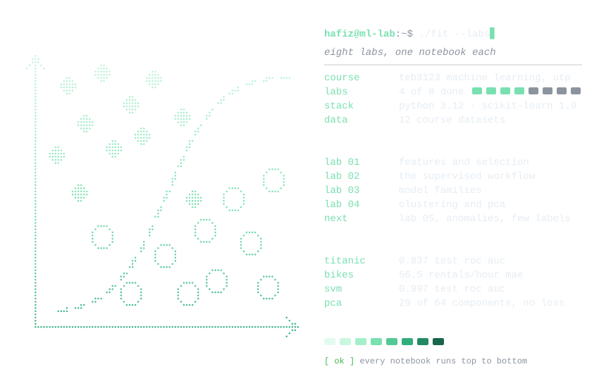
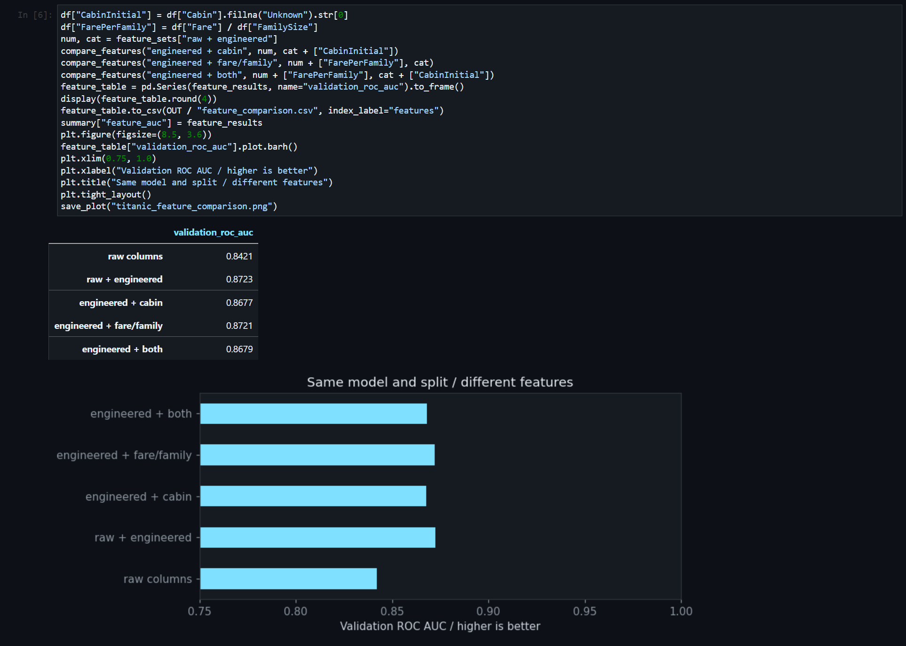
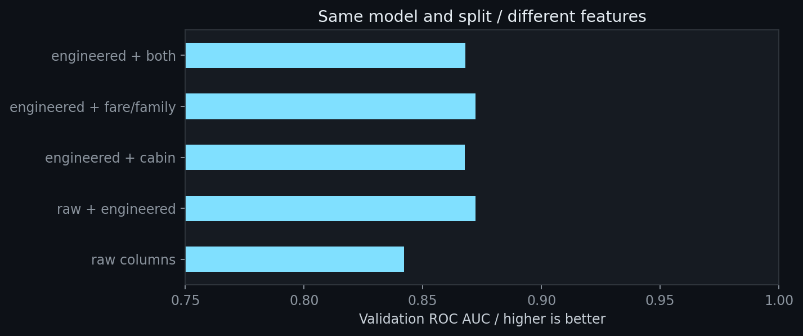
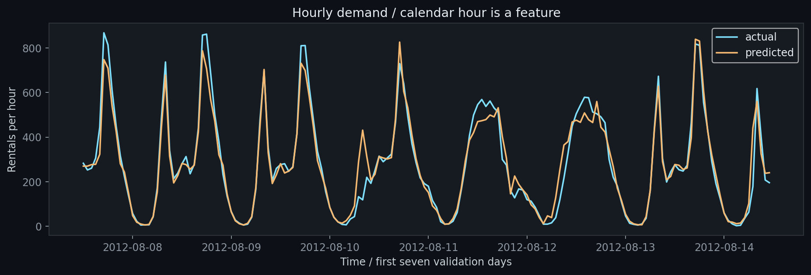
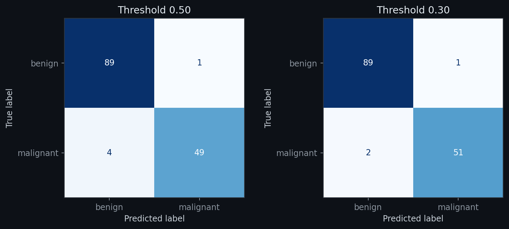

<div align="center">
  <picture>
    <source media="(prefers-color-scheme: dark)" srcset=".github/readme/banner-dark.svg">
    <source media="(prefers-color-scheme: light)" srcset=".github/readme/banner-light.svg">
    
  </picture>
</div>

<div align="center">
  <picture>
    <source media="(prefers-color-scheme: dark)" srcset=".github/readme/card-dark.svg">
    <source media="(prefers-color-scheme: light)" srcset=".github/readme/card-light.svg">
    
  </picture>
</div>

<p align="center">
  
  
  <a href="https://github.com/hafizmnazman/ml-lab/actions/workflows/labs.yml"></a>
</p>

```text
hafiz@ml-lab:~$ cat ./about
machine learning, one experiment at a time.
utp coursework: features, supervised models, and the evidence behind them.

hafiz@ml-lab:~$ cat results/lab01/summary.json
raw features       0.842 validation roc auc
engineered         0.872 validation roc auc

hafiz@ml-lab:~$ cat models/titanic_survival_card.json
cross-validation   0.850 roc auc
held-out test      0.837 roc auc / 223 passengers
```

### <samp>hafiz@ml-lab:~$ open all_experiments/</samp>

<p align="center">
  
</p>

Two worked notebooks with explanations before the code, real executed
outputs, every try-it exercise, and answers to the understanding questions.
Charts and tables are saved beside their machine-readable summaries.

| notebook | what it covers |
|:--|:--|
| [Lab 01](all_experiments/lab01_features_worked.ipynb) | Titanic features, scaling geometry, ridge/SelectKBest/lasso, and leakage |
| [Lab 02](all_experiments/lab02_supervised_workflow_worked.ipynb) | Insurance regression, chronological bike demand, classification, thresholds, CV, and saved models |

### <samp>hafiz@ml-lab:~$ compare --same-split</samp>

<table>
  <tr>
    <td width="50%"><samp>features change the ranking</samp></td>
    <td width="50%"><samp>units change the neighbours</samp></td>
  </tr>
  <tr>
    <td></td>
    <td></td>
  </tr>
  <tr>
    <td>Engineered features improve AUC from 0.842 to 0.872. Cabin and fare-per-family additions do not improve this split further.</td>
    <td>The closest pair changes from tumours 3/5 to 2/5. Scaling belongs inside the training pipeline when evaluating predictions.</td>
  </tr>
</table>

### <samp>hafiz@ml-lab:~$ inspect results/lab02/</samp>

<table>
  <tr>
    <td width="50%"><samp>future dates stay in validation</samp></td>
    <td width="50%"><samp>same model, two decision rules</samp></td>
  </tr>
  <tr>
    <td></td>
    <td></td>
  </tr>
  <tr>
    <td>Hourly MAE: 56.5 rentals. Train on earlier observations; validate on later ones.</td>
    <td>Moving from 0.50 to 0.30 reduces missed positives from 4 to 2, with 1 false alert in this validation sample.</td>
  </tr>
</table>

### <samp>hafiz@ml-lab:~$ cat docs/results.md</samp>

| experiment | evidence from this run |
|:--|:--|
| Titanic / engineered features | 0.872 validation ROC AUC |
| Student grades / lasso | 2.077 validation MAE / 18 of 56 encoded columns retained |
| Insurance / OLS | $4,181.19 validation MAE |
| Bike demand / daily forest | 1040.4 validation MAE / rentals per day |
| Bike demand / hourly forest | 56.5 validation MAE / rentals per hour |
| Titanic / tuned logistic pipeline | 0.837 held-out test ROC AUC |
| Heart disease / extension | 0.932 validation ROC AUC / 0.883 accuracy |

Full metrics, interpretation, and links to the source tables:
[docs/results.md](docs/results.md). The breast-cancer threshold choice is
written in [the decision memo](results/lab02/decision_memo.md).

### <samp>hafiz@ml-lab:~$ ./start-lab.cmd</samp>

On this computer, double-click **`start-lab.cmd`**. JupyterLab opens in your
browser; pick a notebook and the **Python (ml-lab)** kernel. Use Shift+Enter
to run a cell.

For a fresh clone on Windows with Python 3.12:

```powershell
git clone https://github.com/hafizmnazman/ml-lab.git
cd ml-lab
powershell -ExecutionPolicy Bypass -File scripts\setup.ps1
.\start-lab.cmd
```

Python's `.venv` is the course-supported setup used here. See
[docs/setup.md](docs/setup.md) for environment setup, troubleshooting, and
the original-file arrangement.

### <samp>hafiz@ml-lab:~$ python predict_passenger.py</samp>

```powershell
# Execute both labs and regenerate the saved pipelines.
.\.venv\Scripts\python.exe scripts\run_labs.py

# Use the saved model without retraining.
.\.venv\Scripts\python.exe predict_passenger.py --pclass 2 --sex female --age 30 --fare 20
```

```text
survival probability: 0.805  ->  survived
(model: logistic regression pipeline, test ROC AUC 0.8374)
```

The whole preprocessing pipeline is saved, together with a JSON model card.
Binary models remain local and are recreated by Lab 02.

### <samp>hafiz@ml-lab:~$ tree -L 2</samp>

```text
all_datasets/        original course data + checksum manifest
all_experiments/     worked, executed notebooks for labs 01 and 02
models/              saved pipelines (local) + model cards
results/lab01/       feature and selection evidence
results/lab02/       metrics, curves, splits, and decision memo
docs/                setup, reading guide, and measured results
scripts/             setup, notebook runner, and verification
course_materials/    original handouts and starter files (local)
.github/readme/      dark/light terminal art + notebook screenshots
```

### <samp>hafiz@ml-lab:~$ python scripts/verify.py</samp>

Verification checks all 12 dataset hashes, executed notebook cells, disjoint
development/test rows, model-card consistency, threshold counts, and the
prediction CLI from another directory. GitHub Actions reruns both labs and
the checks on every push. To run locally:

```powershell
.\.venv\Scripts\python.exe scripts\verify.py
```

### <samp>hafiz@ml-lab:~$ cat ./notes</samp>

- Preprocessing and feature selection fit on training rows only.
- Titanic's final test is reserved before model comparison and evaluated
  once. This corrects the reused validation/test split in the handout.
- Student `G2` is a deliberate leakage demonstration. A separate comparison
  removes accumulated absences for a stricter enrolment-time forecast.
- Validation metrics are exploratory evidence for these datasets and splits.
  Read the notebook explanations before interpreting coefficients or thresholds.

Study notes and the completed exercise map: [docs/lab-guide.md](docs/lab-guide.md).

<sub>README art and result text are rebuilt from the executed summaries with
<code>python .github/readme/build.py</code>. The screenshot is a browser capture
of the exported, executed notebook.</sub>
